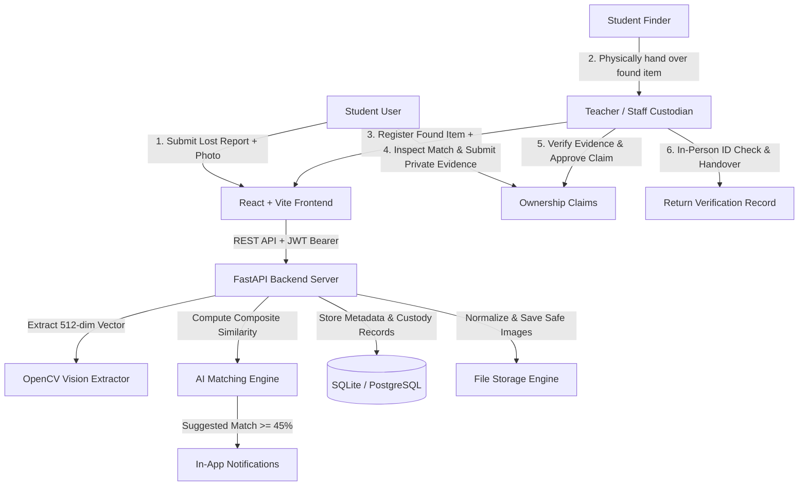

# CampusTrace: AI-Powered Lost & Found Management Platform

CampusTrace is an enterprise-grade full-stack **Lost & Found Management System** engineered for universities and educational institutions. It pairs real-time **Computer Vision feature extraction** (512-dimensional multi-scale spatial color histograms and Sobel gradient descriptors) with an auditable, unbroken **Chain of Custody** protocol.

---

## 1. System Architecture



---

## 2. Key Features & Workflows

### Role-Based Access Control (RBAC)
- **Student (`STUDENT`)**:
  - Report lost belongings with photo uploads.
  - Browse campus found item listings.
  - View AI potential match recommendations.
  - Submit ownership claims with protected confidential evidence.
  - Track in-app notifications.
  - *Restricted*: Cannot approve claims, modify custody records, or mark items as returned.
- **Teacher / Faculty (`TEACHER`)**:
  - Confirm physical intake of items handed over by students.
  - Secure items in campus vault lockers and cabinets.
  - Transfer custody between staff members with timestamped logs.
  - Review and approve/reject claims.
  - Verify student collector identity in person and execute returns.
- **Administrator (`ADMIN`)**:
  - View campus recovery rate percentage and average resolution days.
  - Append-only security audit log of all sensitive events.
  - Monitor computer vision model health and feature dimensions.
  - Manage user directory and storage locations.

### Computer Vision AI Matching Pipeline
- Extracts a **512-dimensional L2-normalized feature vector**:
  - 128 dimensions: Global HSV Color Histograms
  - 144 dimensions: 3x3 Spatial Grid Color Pyramids
  - 16 dimensions: Global Sobel Gradient Orientation Distribution
  - 144 dimensions: Spatial Edge & Texture Magnitude Pyramids
  - 80 dimensions: High-frequency Laplacian variance, edge density, and statistics
- Computes **multimodal composite similarity**:
  $$\text{Composite Score} = 0.60 \times \text{Cosine}(V_{\text{lost}}, V_{\text{found}}) + 0.40 \times \text{Metadata Score}$$
- Signals include: Category match (0.40), Color match (0.25), Temporal proximity (0.20), Location proximity (0.15).

---

## 3. Pre-Seeded Institutional Demo Accounts

| Role | Name | Institutional ID | Email | Password |
|---|---|---|---|---|
| **Student** | Alex Miller | `STU-5001` | `alex.miller@campus.edu` | `Student@123` |
| **Faculty** | Prof. Sarah Jenkins | `TCH-101` | `sarah.jenkins@campus.edu` | `Teacher@123` |
| **Faculty** | Dr. Robert Chen | `TCH-102` | `robert.chen@campus.edu` | `Teacher@123` |
| **Administrator** | Dr. Eleanor Vance | `ADM-001` | `admin@campus.edu` | `Admin@123` |

*Note: The frontend includes a **1-click Demo Role Switcher** in the top navigation bar to preview any role instantly.*

---

## 4. Setup & Running Instructions

### Backend (FastAPI + Python)
1. Open a terminal in the `backend/` directory:
   ```bash
   cd backend
   ```
2. Install Python dependencies:
   ```bash
   pip install -r requirements.txt
   ```
3. Initialize and seed the database with demo campus records:
   ```bash
   python seed.py
   ```
4. Start the backend server:
   ```bash
   python -m uvicorn app.main:app --host 127.0.0.1 --port 8000
   ```
   API Documentation is available at `http://127.0.0.1:8000/api/docs`.

### Frontend (React + Vite + Tailwind CSS)
1. Open a terminal in the `frontend/` directory:
   ```bash
   cd frontend
   ```
2. Install dependencies:
   ```bash
   npm install
   ```
3. Start the Vite development server:
   ```bash
   npm run dev
   ```
   Open your browser at `http://localhost:5173`.

---

## 5. Automated Tests

Run backend unit and integration test suite:
```bash
cd backend
python -m pytest -v
```

All 11 test cases verify:
- Authentication & JWT token issuance
- RBAC authorization boundaries
- Student lost report creation
- Computer vision cosine similarity calculation
- Teacher physical handover intake & custody transfer
- Ownership claim review and in-person return verification
