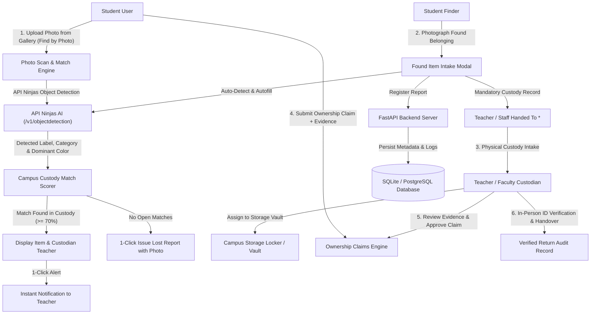

# CampusTrace: Enterprise AI-Powered Campus Lost & Found Platform

CampusTrace is an institutional **Lost & Found Management Platform** engineered for universities and educational institutions. It pairs **cloud object detection via API Ninjas**, an on-device neural vision fallback, and an unbroken, auditable **Chain of Custody** protocol designed around faculty custodians and campus storage vaults.

---

## 1. System Architecture & Workflows



---

## 2. Core Functional Modules

### A. "Find by Photo" (Private Scan & Match)
Designed around how students actually lose items—they cannot take a photo of an item they already lost, but often have pictures of their belongings in their phone gallery:
1. **Private Gallery Upload**: Students upload a photo of their belonging from their phone or computer.
2. **Automated Feature Extraction**: API Ninjas detects the object (`bottle`, `backpack`, `laptop`, `phone`, `keys`, `wallet`, etc.), extracts dominant colors, and maps them to institutional categories.
3. **Campus Custody Matching**: Evaluates the image against all **active, open found items** currently reported across campus.
4. **Custodian Routing**: If a matching item is already in campus custody, the student is shown the custodian teacher's name and location, with a **1-click Custodian Alert** to notify the teacher without revealing private data.
5. **Seamless Report Issuance**: If no matches exist, the student can convert their uploaded photo directly into an official Lost Report in one click.

### B. "Found an item? Report it." (Traceable Custody Intake)
1. **Clean Intake Dialog**: Mounted in a high-priority portal (`createPortal`) with drag-and-drop, gallery upload, and an optional live webcam toggle.
2. **Instant Object Auto-Fill**: Automatically fills Title, Category, Color, and Circumstances based on the uploaded image.
3. **Prime Feature — Teacher / Staff Handed To**:
   - Marking physical custody is mandatory (`required *`) when reporting found items.
   - Requires recording the professor, lab incharge, or department desk who received physical custody.
4. **Storage Vault Allocation**: Authorized faculty and administrators assign items to designated campus storage vaults (e.g., *Physics Lab Locker*, *CS Dept Cabinet*).

### C. Ownership Claims & Verification
1. **Confidential Evidence**: Students claim items by providing non-public details (lock screen wallpaper, serial numbers, specific scratches, unique keychain marks).
2. **Faculty Verification**: Teachers review claims, inspect submitted evidence, and approve or reject claims.
3. **In-Person Handover Audit**: The physical handover is verified against the student's institutional ID card, creating an append-only return record.

---

## 3. Technology Stack

| Layer | Technologies & Frameworks |
|---|---|
| **Frontend** | React 19, TypeScript, Vite, Tailwind CSS v4, Lucide Icons, React Router v7 |
| **Backend** | FastAPI, Python 3.11+, SQLAlchemy 2.0 ORM, Pydantic v2 schemas, SQLite / PostgreSQL |
| **AI & Vision** | **API Ninjas Object Detection API**, OpenCV 512-dim color-spatial descriptor vector, ONNX WebAssembly Runtime (MobileNetV2 fallback) |
| **Authentication** | JWT Bearer Authentication, Password Hashing (Passlib / PBKDF2), Role-Based Access Control |
| **UI Components** | Symmetrical Dual Hero Cards (Indigo/Purple Scan & Emerald/Teal Intake), Glassmorphism, Responsive Mobile Bottom Navigation & Desktop Navbar |

---

## 4. Role-Based Access Control (RBAC)

| Capability | Student (`STUDENT`) | Faculty Custodian (`TEACHER`) | Campus Administrator (`ADMIN`) |
|---|:---:|:---:|:---:|
| Find by Photo (Private Scan) | Yes | Yes | Yes |
| Report Lost / Found Belongings | Yes | Yes | Yes |
| Enter "Teacher Handed To" Record | Yes (Required) | Yes | Yes |
| View Campus Feed & Listings | Yes | Yes | Yes |
| Submit Ownership Claim | Yes | No | No |
| Faculty Custody Queue (`/custody`) | Restricted | Yes | Yes |
| Assign Storage Vaults | Restricted | Yes | Yes |
| Transfer Custody Between Staff | Restricted | Yes | Yes |
| Approve / Reject Ownership Claims | Restricted | Yes | Yes |
| Perform In-Person Return Handover | Restricted | Yes | Yes |
| Campus Audit Logs & Oversight | Restricted | Restricted | Yes |

---

## 5. API Ninjas Configuration

CampusTrace utilizes the **API Ninjas Object Detection API** (`https://api.api-ninjas.com/v1/objectdetection`) to identify items, determine categories, and extract visual attributes.

### Environment Variable Setup
1. Create or edit `backend/.env`:
   ```env
   # API Ninjas Configuration
   API_NINJAS_API_KEY=your_actual_api_ninjas_key_here
   ```
2. A template is provided in `backend/.env.example`:
   ```env
   API_NINJAS_API_KEY=PASTE_YOUR_API_KEY_HERE
   ```
3. *Security Note*: The API key is stored strictly on the server and is never exposed to browser requests, client bundles, or frontend environment variables.

---

## 6. Key API Endpoints

### AI Detection & Photo Matching
| Method | Endpoint | Description |
|---|---|---|
| `POST` | `/api/detection/scan-and-match` | Scans a gallery photo against open campus reports, returning high-confidence candidates and custodian teacher info |
| `POST` | `/api/detection/detect-object` | Runs object detection on an image, returning label, confidence, dominant color, and category |
| `POST` | `/api/detection/alert-custodian` | Sends an in-app notification to the teacher holding a matched item |
| `GET` | `/api/detection/status` | Returns the configuration status of the AI detection service |

### Reports & Feed
| Method | Endpoint | Description |
|---|---|---|
| `GET` | `/api/reports` | Paginated campus feed with search, category, location, and status filters |
| `POST` | `/api/reports` | Create lost or found report (supports `handed_over_teacher_name`) |
| `GET` | `/api/reports/{id}` | Retrieve comprehensive report details, images, and custody history |
| `PATCH` | `/api/reports/{id}` | Update report details or change status |

### Custody & Returns
| Method | Endpoint | Description |
|---|---|---|
| `GET` | `/api/custody/queue` | Active faculty custody queue of items in campus storage vaults |
| `POST` | `/api/custody/intake` | Confirm physical intake of an item surrendered by a student |
| `POST` | `/api/custody/transfer` | Transfer physical custody between faculty members with timestamped logs |
| `GET` | `/api/custody/storage-locations` | List campus storage lockers, vaults, and cabinets |
| `POST` | `/api/returns` | Verify student collector ID in person and issue verified return record |

### Claims & Notifications
| Method | Endpoint | Description |
|---|---|---|
| `POST` | `/api/claims` | File ownership claim with private verification evidence |
| `GET` | `/api/claims` | View pending and resolved claims |
| `PATCH` | `/api/claims/{id}` | Approve or reject a claim (Faculty/Admin only) |
| `GET` | `/api/notifications` | In-app alerts for match recommendations, claims, and custodian alerts |

---

## 7. Pre-Seeded Institutional Demo Accounts

| Role | Name | Institutional ID | Email | Password |
|---|---|---|---|---|
| **Student** | Alex Miller | `STU-5001` | `alex.miller@campus.edu` | `Student@123` |
| **Faculty Custodian** | Prof. Sarah Jenkins | `TCH-101` | `sarah.jenkins@campus.edu` | `Teacher@123` |
| **Faculty Custodian** | Dr. Robert Chen | `TCH-102` | `robert.chen@campus.edu` | `Teacher@123` |
| **Campus Admin** | Dr. Eleanor Vance | `ADM-001` | `admin@campus.edu` | `Admin@123` |

*Tip: The top navigation bar includes a **1-click Role Switcher** to switch between Student, Faculty, and Admin views instantly.*

---

## 8. Setup & Installation

### Prerequisites
- Python 3.11+
- Node.js 18+ and npm
- Valid [API Ninjas](https://api-ninjas.com/) API Key

### Backend Setup
1. Navigate to the `backend/` directory:
   ```bash
   cd backend
   ```
2. Create and activate a virtual environment:
   ```bash
   python -m venv venv
   # Windows:
   .\venv\Scripts\activate
   # macOS/Linux:
   source venv/bin/activate
   ```
3. Install dependencies:
   ```bash
   pip install -r requirements.txt
   ```
4. Set up environment variables:
   ```bash
   cp .env.example .env
   # Edit .env and paste your API_NINJAS_API_KEY
   ```
5. Seed database with initial categories, campus locations, storage vaults, and demo users:
   ```bash
   python seed.py
   ```
6. Start the FastAPI development server:
   ```bash
   python -m uvicorn app.main:app --host 127.0.0.1 --port 8000 --reload
   ```
   Interactive Swagger API docs: `http://127.0.0.1:8000/api/docs`.

### Frontend Setup
1. Navigate to the `frontend/` directory:
   ```bash
   cd frontend
   ```
2. Install dependencies:
   ```bash
   npm install
   ```
3. Start the Vite development server:
   ```bash
   npm run dev
   ```
4. Access the web application at `http://localhost:5173`.

---

## 9. Verification & Testing

### Backend Unit & Integration Tests
```bash
cd backend
python -m pytest tests/test_ninja_detection.py -v
```
Verifies:
- API Ninjas status endpoint and secure environment configuration
- Missing API key handling (`503 Service Unavailable`)
- MIME type validation and error handling
- Successful response parsing and campus category normalization

### Frontend Production Build
```bash
cd frontend
npm run build
```
Runs TypeScript verification (`tsc -b`) and Vite production bundling with zero errors.
