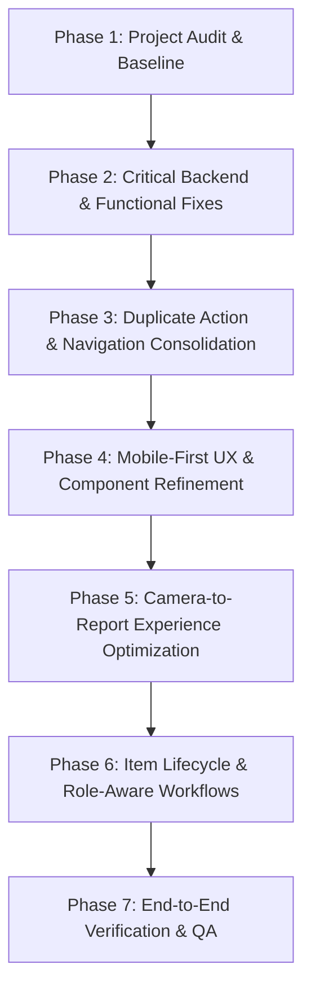

# CampusTrace Implementation Plan

**Date**: October 16, 2026  
**Document**: `docs/IMPLEMENTATION_PLAN.md`  
**Reference**: `docs/PROJECT_AUDIT.md`  

---

## 1. Phase Breakdown & Execution Sequence

---

## 2. Phase 2 — Critical Backend & Functional Fixes

### Task 2.1: Repair Broken Notification Routing
- **Problem**: Backend generates dead notification URLs (`/teacher/claims/{claim.id}`, `/teacher/reports/{report.id}`) which cause 404/redirect errors in the frontend.
- **Affected Files**:
  - `backend/app/api/claims.py` (line 79)
  - `backend/app/api/custody.py` (line 173)
  - `backend/app/services/matching_engine.py` (line 243)
- **Fix**: Update URLs to valid frontend routes:
  - `/claims?claim_id={claim.id}` for claims notifications
  - `/reports/{report.id}` for reports notifications
  - `/reports/{found_rep.id}` for match notifications
- **Verification**: Run `pytest tests/test_api.py`. Click generated notifications in UI to verify smooth navigation.

### Task 2.2: Add Frontend Role-Based Route Guards
- **Problem**: Any user can navigate to `/admin` or `/custody`, triggering backend 403 errors and broken UI states.
- **Affected Files**:
  - `frontend/src/App.tsx`
- **Fix**: Implement a `RoleGuard` component in `App.tsx` checking allowed roles (`allowedRoles={['ADMIN']}` and `allowedRoles={['TEACHER', 'ADMIN']}`). Redirect unauthorized users to `/` with an informative toast or alert.
- **Verification**: Sign in as `STU-5001` (Student) and attempt to access `/admin` and `/custody`. Verify safe redirection to Home.

### Task 2.3: Fix Return Verification Claim Selection
- **Problem**: `ReportDetailPage.tsx` Modal 3 asks teachers to manually type an integer `Claim ID` into an input box.
- **Affected Files**:
  - `frontend/src/pages/ReportDetailPage.tsx`
- **Fix**:
  - Fetch claims associated with the report or filter from existing report claims.
  - Present a `<select>` dropdown populated with approved claims showing claimant name, USN, and date.
  - Check for a `?claim_id=xyz` or `?action=return` query parameter from `ClaimsPage` navigation to pre-populate the modal.
- **Verification**: Open a found report with an approved claim as a Teacher, click "Verify & Release Return", and confirm the dropdown displays the approved claimant without manual ID typing.

### Task 2.4: Modernize Pydantic Schemas & Resolve Datetime Deprecations
- **Problem**: 8 Pydantic v2 deprecation warnings and 43 `datetime.utcnow()` warnings on every test run.
- **Affected Files**:
  - `backend/app/schemas/*.py` (`item.py`, `match.py`, `claim.py`, `return_record.py`, `notification.py`, `admin.py`)
  - `backend/app/services/auth_service.py`
  - `backend/app/api/reports.py`
- **Fix**: Replace `class Config: from_attributes = True` with `model_config = ConfigDict(from_attributes=True)` and replace `datetime.utcnow()` with timezone-aware `datetime.now(timezone.utc)`.
- **Verification**: Run `pytest -v` and confirm reduction in deprecation warnings.

### Task 2.5: Safe Error Logging in Image Matching
- **Problem**: `backend/app/api/reports.py` lines 453-456 silently swallows exceptions during image upload matching.
- **Affected Files**:
  - `backend/app/api/reports.py`
- **Fix**: Add structured error logging (`logger.error(...)`) with stack trace when auto-matching encounters an issue.

---

## 3. Phase 3 — Duplicate Action & Navigation Consolidation

### Task 3.1: Unify Report Entry Points onto `ReportFlowContext`
- **Problem**: `ListingsPage.tsx` links to legacy `/report/lost` and `/report/found`, while navbar and bottom nav open `CameraReportFlow`.
- **Affected Files**:
  - `frontend/src/pages/ListingsPage.tsx`
  - `frontend/src/App.tsx`
- **Fix**:
  - Replace direct `/report/lost` and `/report/found` links in `ListingsPage.tsx` with calls to `openReportFlow('LOST')` and `openReportFlow('FOUND')`.
  - In `App.tsx`, keep direct `/report/lost` and `/report/found` routes as redirects or seamless wrappers that launch the camera flow, ensuring external/saved bookmarks don't break.
- **Verification**: Click report buttons in header, listings page, and mobile bottom nav; all open the unified camera flow.

### Task 3.2: Remove Obsolete Layout Files & Clean Linter Warnings
- **Problem**: `Navbar.tsx` and `Sidebar.tsx` are unused dead code. `ProfilePage.tsx` has 20+ unused imports and React Compiler warnings.
- **Affected Files**:
  - `frontend/src/components/layout/Navbar.tsx`
  - `frontend/src/components/layout/Sidebar.tsx`
  - `frontend/src/pages/ProfilePage.tsx`
- **Fix**: Safely remove unused files and clean up `ProfilePage.tsx` imports and effect variable initialization order.
- **Verification**: Run `npm run lint` and verify significant drop in warnings.

---

## 4. Phase 4 — Mobile-First UX Refinement

### Task 4.1: Responsive Layouts & Safe-Area Adjustments
- **Problem**: Fixed bottom navigation covers inputs; modals can clip on narrow screens with virtual keyboards.
- **Affected Files**:
  - `frontend/src/App.tsx` (`ProtectedLayout`)
  - `frontend/src/components/layout/BottomNav.tsx`
  - `frontend/src/pages/ReportDetailPage.tsx`
  - `frontend/src/components/camera/CameraReportFlow.tsx`
- **Fix**:
  - Maintain consistent padding `pb-24` on mobile and `pb-8` on desktop.
  - Add safe area inset support (`pb-[calc(env(safe-area-inset-bottom,0px)+4rem)]`).
  - Add `max-h-[90vh] overflow-y-auto` to all modals with sticky header/footer actions.
- **Verification**: Test rendering at 320px, 375px, 390px, and 430px viewports.

### Task 4.2: Filter Toolbar Wrapping & Touch Targets
- **Problem**: Segmented buttons in `ListingsPage.tsx` wrap unevenly on small screens.
- **Affected Files**:
  - `frontend/src/pages/ListingsPage.tsx`
  - `frontend/src/pages/MatchesPage.tsx`
- **Fix**: Implement horizontally scrolling filter chips (`overflow-x-auto scrollbar-none`) with touch targets >= 44px.

---

## 5. Phase 5 — Camera-to-Report Experience Optimization

### Task 5.1: Live Camera, Shutter, and Desktop Drag-and-Drop
- **Problem**: Camera flow needs smooth desktop drag-and-drop when a webcam is not available, and clear camera permission guidance.
- **Affected Files**:
  - `frontend/src/components/camera/CameraReportFlow.tsx`
- **Fix**:
  - Add desktop drag-and-drop zone to the capture step when live video is inactive or denied.
  - Retain preferred `facingMode: 'environment'` for mobile rear camera.
  - Ensure single-click submission prevention (`disabled={isSubmitting}`).
- **Verification**: Test taking photo with webcam / upload file / drag-and-drop. Verify AI analysis and form pre-fill.

---

## 6. Phase 6 — Role-Aware Dashboard & Complete Lifecycle

### Task 6.1: Make `HomeScreen.tsx` Role-Aware
- **Problem**: Currently, teachers and admins see student-focused greeting and prompt on `/`. Teachers must separately find the custody queue.
- **Affected Files**:
  - `frontend/src/pages/HomeScreen.tsx`
- **Fix**:
  - For `TEACHER`: Display urgent Physical Intake Queue card (items handed over by finders awaiting teacher verification), active vault count, and pending claims count.
  - For `ADMIN`: Display recovery percentage, total items, model health status, and quick link to admin portal.
  - For `STUDENT`: Retain the high-converting camera-to-report hero card, personal report status, and match recommendations.
- **Verification**: Log in as Student (`alex.miller@campus.edu`), Teacher (`sarah.jenkins@campus.edu`), and Admin (`admin@campus.edu`). Verify home screen adapts cleanly.

---

## 7. Phase 7 — Verification & Documentation

### Task 7.1: Automated Checks & Workflow Validation
- Run backend tests: `python -m pytest -v`.
- Run frontend lint: `npm run lint`.
- Run production build: `npm run build`.
- Validate full student-to-teacher lifecycle:
  1. Student reports lost item with image.
  2. Student/Finder reports found item.
  3. Teacher confirms physical receipt into vault.
  4. Matching engine generates match suggestion.
  5. Student inspects match and submits ownership claim.
  6. Teacher reviews and approves claim.
  7. Teacher verifies student ID and executes return.
  8. Report status reflects `RETURNED` with complete chain of custody.

### Task 7.2: Generate Deliverables
- Update `docs/CHANGELOG_REFINEMENT.md`.
- Update `docs/TEST_RESULTS.md`.
